# Part 1: Bones pràctiques en la documentació de commits

## Crear el README

## Commit "docs: inicialitza la repositori de prova per tasca 2"

## Crear el fitxer 00-installer-config.yaml
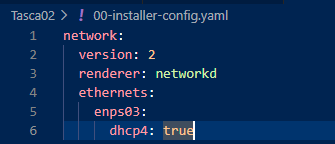

# Part 2: L'historial del repositori

## Observa l'historial del teu repositori amb l'historial detallat, identificant la informació disponible per cada commit
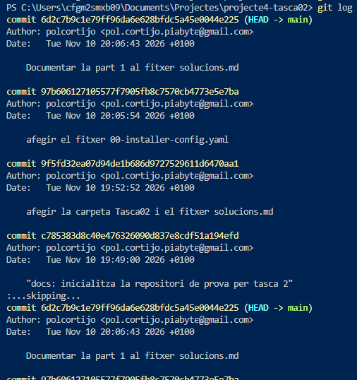

## Compara el resultat amb l'historial resumit
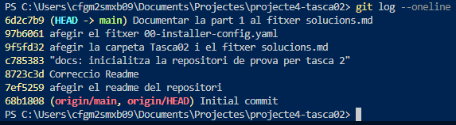

## Usa l'eina gràfica de l'editor VS Code per veure l'historial del repositori i comparar-lo amb el que has vist a la terminal

## Inspecciona els canvis exactes del darrer commit

## Observa també la mateixa informació amb l'eina gràfica de l'editor VS Code, seleccionant el darrer commit.

# Part 3: Recuperar versions anteriors del working directory

## Simularem un error humà editant el fitxer 00-installer-config.yaml
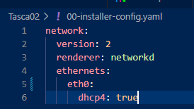

## Observa l'estat del repositori. A l'editor VS Code, veuràs que el fitxer interficies.yaml apareix amb una M, indicant que ha estat modificat.

## A la terminal, executa la comanda al terminal per comprovar com t'indica aquesta situació
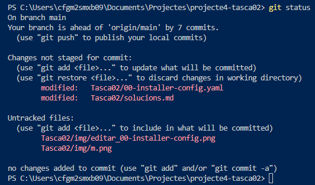

## Desfem els canvis del fitxer interficies.yaml i tornem-lo a l'estat del darrer commit. Això es pot fer gràficament a l'editor VS Code, fent clic amb el botó dret sobre el fitxer i seleccionant l'opció "Discard changes". També es pot fer des de la terminal amb la comanda
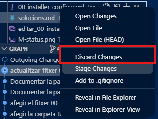

## Pots comprovar que l'estat del repositori és correcte amb la comanda git status
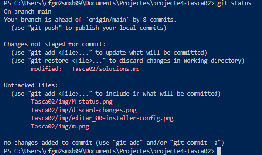

# Part 4: Recuperar versions anteriors (commits) del repositori

## Editarem l'arxiu 00-installer-config.yaml i modificarem el valor de dhcp4 a false i afegirem una un configuració estàtica a la interfície enps03
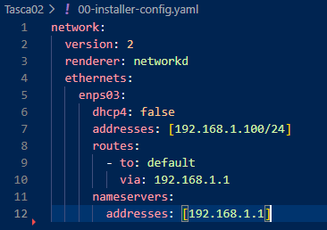

## Editem de nou l'arxiu, ara per configurar una segona interfície enps08 en mode DHCP
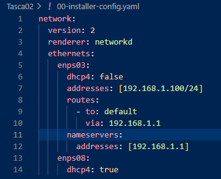

## Per últim, incorporem canviem els servidor DNS a la configuració de la interfície enps03, perquè la configuració inicial no funcionava correctament
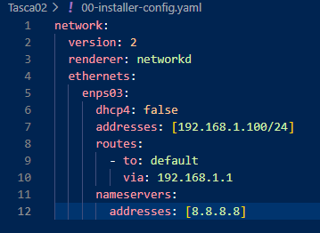

## Revisa ara l'historial del repositori amb la comanda git log --oneline o amb l'eina gràfica per veure tot l'historial de commits realitzats
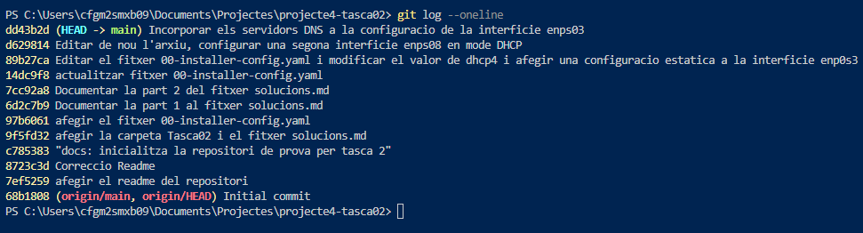

## Anem a documentar un exemple de revert d'un commit
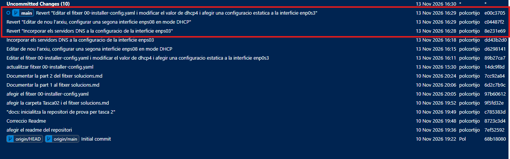

## Explorar un commit anterior
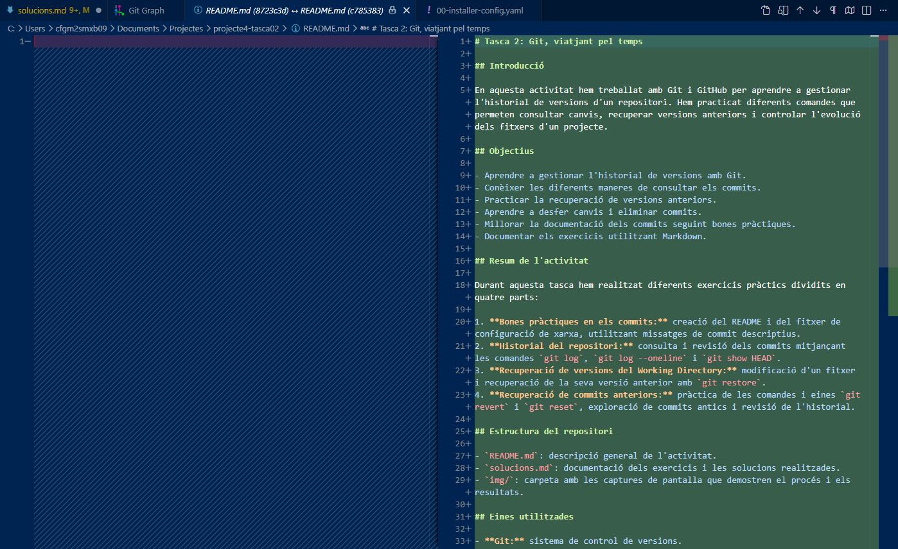

## Finalment, tot i que no és un procediment recomanat, anem a eliminar el darrer commit (git reset)
- Mostra l'historial actual amb la comanda git log --oneline
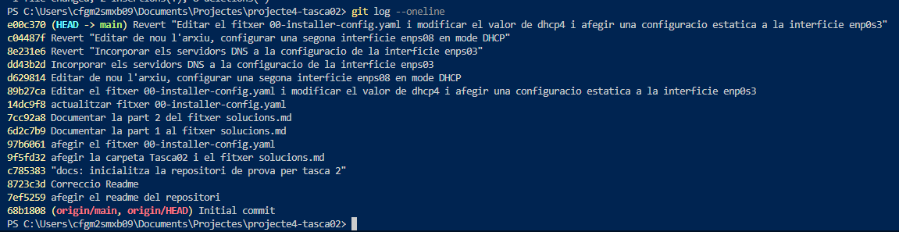
- Elimina el darrer commit bé sigui amb la comanda git reset --hard HEAD~1 o amb l'eina gràfica
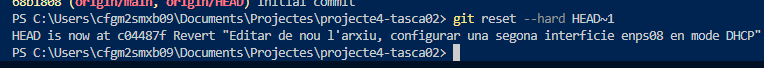
- Indica l'estat del repositori amb la comanda git status i mostra l'historial amb la comanda git log --oneline
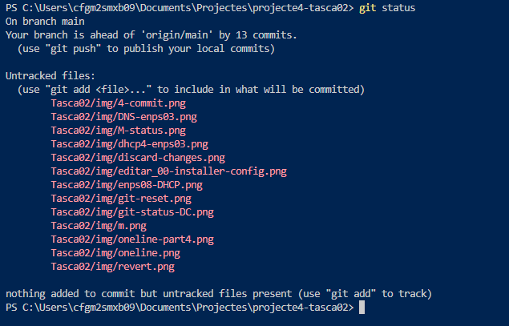
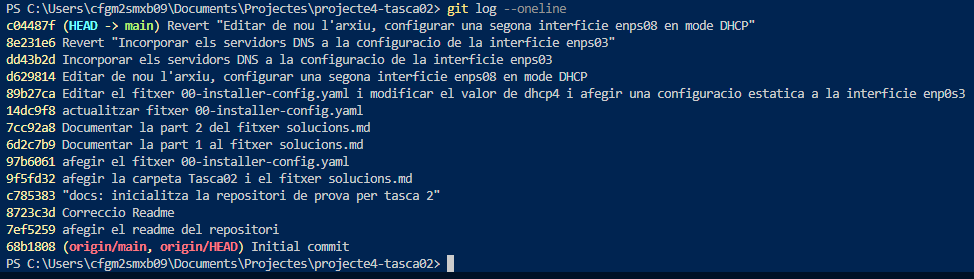