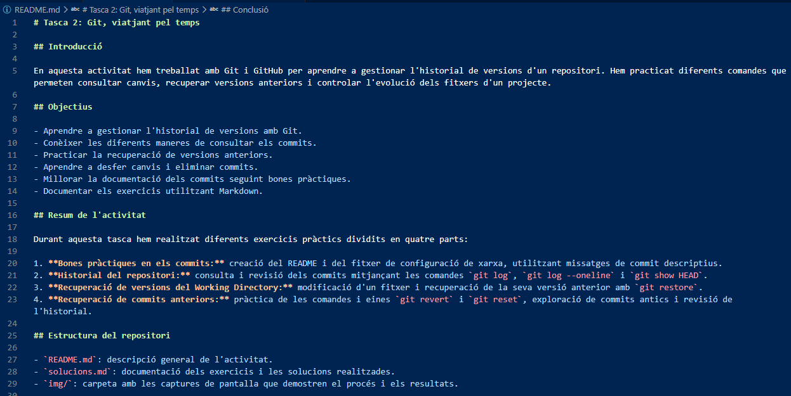
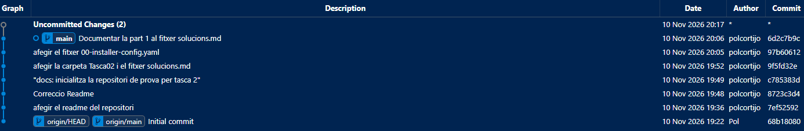
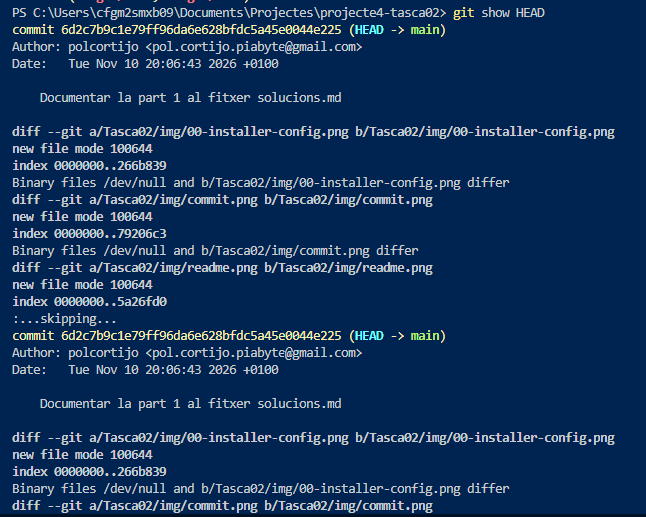
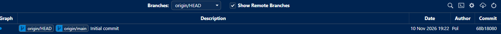

# Part 1: Bones pràctiques en la documentació de commits

## Crear el README

## Commit "docs: inicialitza la repositori de prova per tasca 2"

## Crear el fitxer 00-installer-config.yaml

# Part 2: L'historial del repositori

## Observa l'historial del teu repositori amb l'historial detallat, identificant la informació disponible per cada commit

## Compara el resultat amb l'historial resumit

## Usa l'eina gràfica de l'editor VS Code per veure l'historial del repositori i comparar-lo amb el que has vist a la terminal

## Inspecciona els canvis exactes del darrer commit

## Observa també la mateixa informació amb l'eina gràfica de l'editor VS Code, seleccionant el darrer commit.

